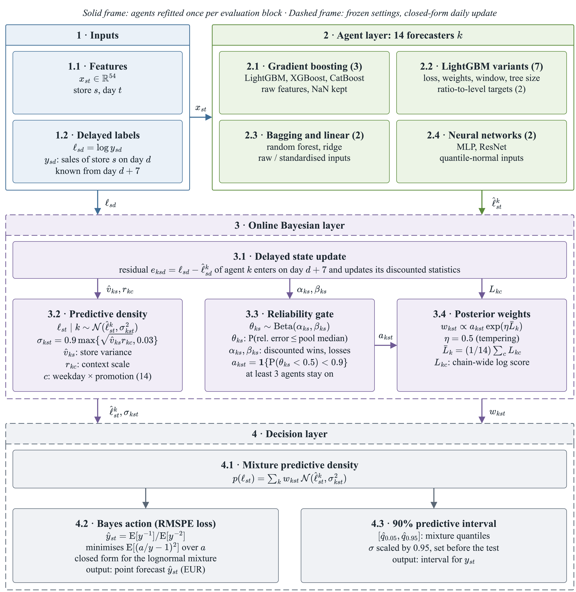
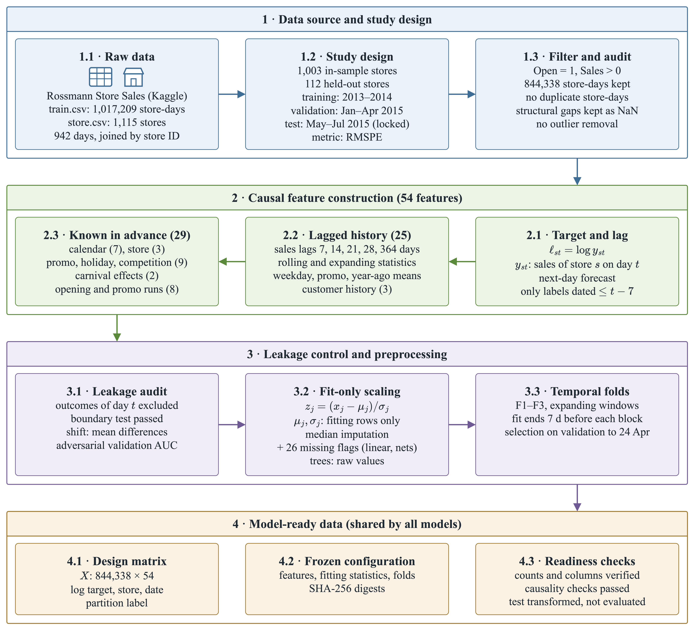
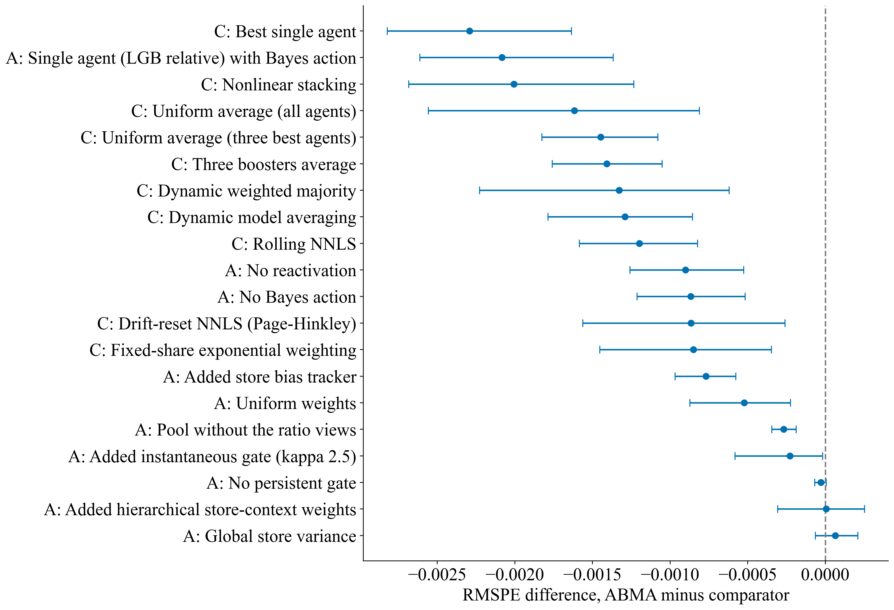
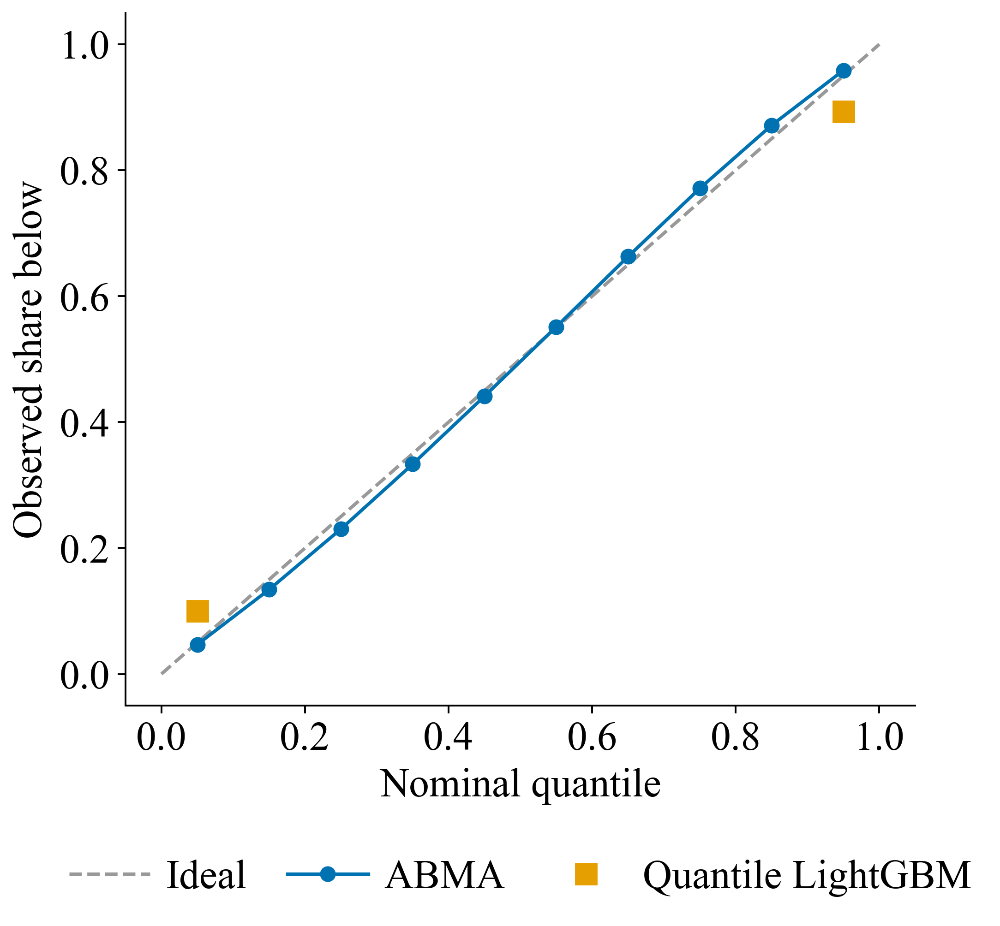
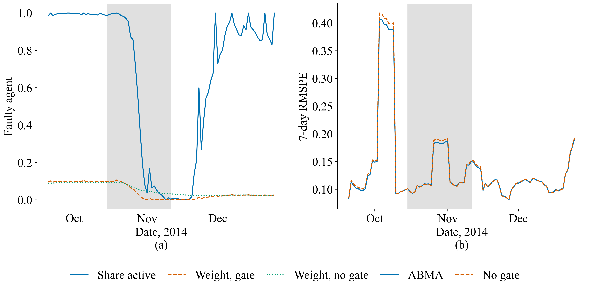
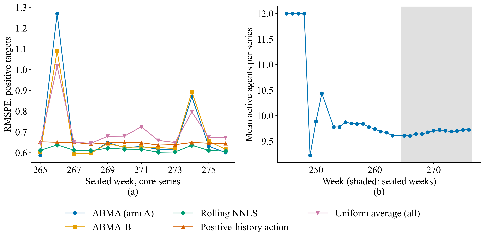
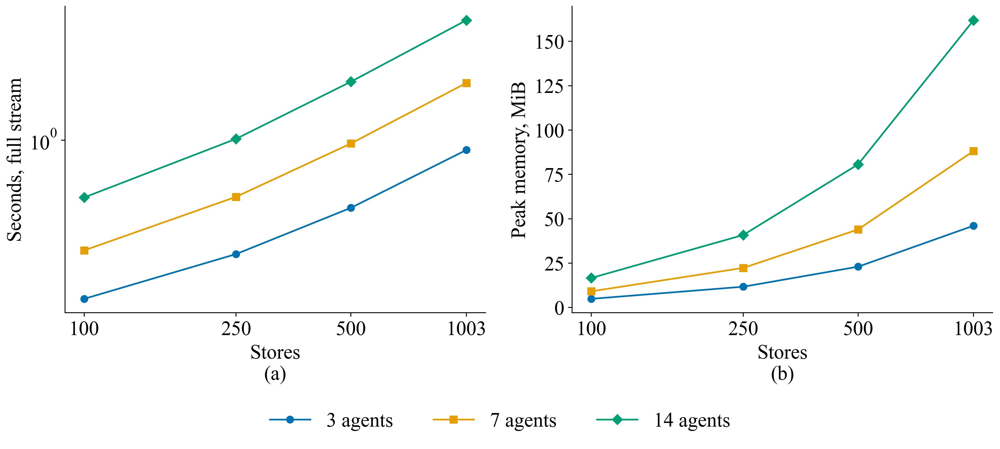

# ABMA: Adaptive Bayesian Multi-Agent Combination of Retail Sales Forecasters under Delayed Labels


ABMA is an online combination layer for heterogeneous forecasting models (gradient boosting, random forest, ridge
regression, tabular neural networks). It treats the trained models as *agents* and updates, in closed form and only
from labels that have already been published, a predictive density for every agent in every store, tempered posterior
weights and a Beta reliability state that switches an agent off and back on in a single store. The point forecast is
the Bayes action for the squared percentage error, which is the loss behind the root mean squared percentage error
(RMSPE). This repository contains the complete experimental pipeline on three public retail panels: daily store
revenue of the Rossmann chain (seven-day label delay) and two weekly count panels (UCI Sales Transactions Weekly
and M5/Walmart, two-week lag).

## Datasets

The study uses three public retail sales panels. All raw files read by the notebooks live in [`dataset/`](dataset/):
[`dataset/README.md`](dataset/README.md) lists the files with their SHA-256 checksums, and
[`dataset/download_data.py`](dataset/download_data.py) fetches the two files that are not stored in this repository
and verifies all of them.

| | Rossmann Store Sales | UCI Sales Transactions Weekly | M5 Forecasting – Accuracy |
|---|---|---|---|
| Original source | [Kaggle competition](https://www.kaggle.com/competitions/rossmann-store-sales) | [UCI Machine Learning Repository](https://archive.ics.uci.edu/dataset/396/sales+transactions+dataset+weekly), DOI [10.24432/C5XS4Q](https://doi.org/10.24432/C5XS4Q) | [Kaggle competition](https://www.kaggle.com/competitions/m5-forecasting-accuracy); copy on Zenodo, DOI [10.5281/zenodo.12636070](https://doi.org/10.5281/zenodo.12636070) |
| Content | 1,017,209 daily records of 1115 Rossmann stores, 1 January 2013 – 31 July 2015: sales in euros, customers, opening flag, promotion, state and school holidays; static store attributes (store type, assortment, competitor distance and opening date, long-running promotion) | weekly purchased quantities of 811 products over 52 weeks (raw columns W0–W51 and their normalised copies) | daily unit sales of 30,490 Walmart item-store series (3049 items in 10 stores in California, Texas and Wisconsin), 29 January 2011 – 22 May 2016 (1941 days), with a calendar of events and SNAP days and weekly sell prices |
| Files used | `train.csv`, `store.csv` | `Sales_Transactions_Dataset_Weekly.csv` in `source.zip` | `sales_train_evaluation.csv`, `calendar.csv`, `sell_prices.csv` in `m5-forecasting-accuracy.zip` |
| Licence / terms | Kaggle competition rules | CC BY 4.0 | Kaggle competition rules; the Zenodo copy is labelled CC BY 4.0 |
| In this repository | `dataset/raw/rossmann/`, downloaded with the Kaggle API (redistribution is not permitted) | stored in `dataset/raw/UCI_SalesTransactionsWeekly/source.zip` | `dataset/raw/m5/`, downloaded from Zenodo by the script |

How the data are used:

- **Rossmann (primary panel, part A of every notebook).** Only days on which a store was open and had positive sales
  are modelled (844,338 store-days); closed days are structural zeros, not missing values. 112 randomly drawn stores
  are held out from all training; the other 1003 stores are split in time into training (2013–2014), validation
  (January–April 2015) and the final evaluation period (May–July 2015). Actual sales are assumed to become available
  seven days after the sales day, so every predictor of day $`t`$ uses sales up to day $`t-7`$ only, and same-day customer
  counts enter only as lagged values. Models are trained on log sales; RMSPE is computed in euros.
- **UCI Sales Transactions Weekly (weekly transfer panel, part B).** The raw weekly quantities W0–W51 are used; the
  normalised columns are not. 729 products form the core panel and 82 products are held out; weeks 40–51 are the test
  weeks, and labels become available with a delay of two weeks. About a quarter of the targets are zero, so RMSPE is
  computed on positive targets.
- **M5 (weekly transfer panel, part C).** Daily unit sales are summed to 277 complete weeks. 27,441 series form the core
  panel and 3049 series are held out; weeks 265–276 are the test weeks and were read once, after the model configuration
  had been fixed. Labels become available with a delay of two weeks; weekly prices, events and SNAP days enter as
  covariates known in advance.
- The two weekly panels test whether the configuration fixed on Rossmann transfers to small, intermittent counts
  without retuning. All intermediate data (merged panels, causal features, splits, forecasts) are rebuilt by the
  notebooks in `outputs/`.

Data references: Rossmann Store Sales, Kaggle, 2015; J. Tan, *Sales Transactions Weekly*, UCI Machine Learning
Repository, 2014, https://doi.org/10.24432/C5XS4Q (data described in S. C. Tan and J. P. S. Lau, 2014,
https://doi.org/10.1007/978-981-4585-18-7_28); S. Makridakis, E. Spiliotis and V. Assimakopoulos, *M5 accuracy
competition: Results, findings, and conclusions*, International Journal of Forecasting 38 (2022) 1346–1364,
https://doi.org/10.1016/j.ijforecast.2021.11.013.

## Highlights

- **Rossmann, final period (May–July 2015, 1003 stores):** RMSPE 0.09998 against 0.10083 for the best of ten
  established combiners and 0.10225 for LightGBM; significantly better than all 17 comparators in a store-cluster
  bootstrap with Holm correction, not significant in a day-level Newey–West test.
- **112 held-out stores:** first by RMSPE (0.10119).
- **Calibrated uncertainty:** the 90% intervals of the agent mixture cover 91.2% of outcomes, against 79.3%
  for quantile LightGBM.
- **Streaming cost:** 3.3 s and 162 MiB for 370,863 store-day updates with 14 agents; time grows at most
  linearly with store-days.
- **Boundary of the method:** on weekly intermittent counts (UCI, M5) ABMA does not beat the strongest simple
  combiners; the reliability gate is harmful on M5, and the Bayes action remains necessary on every panel.

## Method

<p align="center"></p>

For store $`s`$, day $`t`$ and agent $`k`$ with log-sales forecast $`\hat{\ell}^{(k)}_{s,t}`$, the online layer keeps

- a **predictive density** $`\ell_{s,t} \mid k \sim \mathcal{N}\big(\hat{\ell}^{(k)}_{s,t},\ \sigma^{2}_{k,s,t}\big)`$, where
  $`\sigma^{2}_{k,s,t}`$ combines a discounted per-store residual variance with a weekday × promotion context
  multiplier;
- **tempered posterior weights** $`w_{k,s,t} \propto a_{k,s,t}\,\exp\big(\eta\,\bar{L}_{k}\big)`$, where $`\bar{L}_{k}`$ is
  the discounted log score of agent $`k`$, $`a_{k,s,t} \in \{0, 1\}`$ is its activity indicator and $`\eta = 0.5`$;
- a **reliability gate with reactivation**: the share $`\theta_{k,s}`$ of days on which agent $`k`$ is not worse than
  the pool median in store $`s`$ has a discounted Beta posterior; the agent is inactive in that store while
  $`P(\theta_{k,s} < 0.5) \ge 0.9`$ and returns when its accuracy recovers;
- the **Bayes action** for the squared percentage error of the lognormal mixture, together with 90% mixture
  quantiles:

```math
\hat{y}_{s,t}
= \frac{\mathrm{E}\left[y^{-1}\right]}{\mathrm{E}\left[y^{-2}\right]}
= \frac{\sum_{k} w_{k,s,t}\,\exp\left(-\hat{\ell}^{(k)}_{s,t} + \tfrac{1}{2}\sigma^{2}_{k,s,t}\right)}
       {\sum_{k} w_{k,s,t}\,\exp\left(-2\hat{\ell}^{(k)}_{s,t} + 2\sigma^{2}_{k,s,t}\right)}.
```

All updates use only labels published at least seven days (Rossmann) or two weeks (weekly panels) before the
forecast origin. Each update costs $`O(K)`$ operations per store-day for $`K`$ agents.

## Data and evaluation protocol

<p align="center"></p>

| Panel | Unit | Size | Label delay | Test period |
|---|---|---|---|---|
| Rossmann Store Sales | store, daily revenue | 1115 stores × 942 days (844,338 open store-days) | 7 days | May–July 2015; 1003 core and 112 held-out stores |
| UCI Sales Transactions Weekly | product, weekly units | 811 products × 52 weeks | 2 weeks | weeks 40–51; 729 core and 82 held-out products |
| M5 Forecasting – Accuracy | item-store, weekly units | 30,490 series × 277 weeks | 2 weeks | weeks 265–276; 27,441 core and 3049 held-out series |

- 54 causal features (calendar, promotion and holiday schedules, store attributes, lagged and rolling sales history);
  every history feature uses only sales published before the forecast origin, which is verified by a label
  permutation test.
- Expanding development windows (F1 warm-up; F2, F3 and V scored) with training ending seven days before each block;
  all preprocessing is fitted on training rows only.
- 14 agents: ridge regression, random forest, LightGBM, XGBoost, CatBoost, MLP, ResNet and seven LightGBM variants.
- Ten comparator combiners with tuning budgets of 30–80 configurations (ABMA: 40): equal-weight means, best single
  agent, rolling and drift-reset NNLS, nonlinear stacking, dynamic model averaging, fixed share and dynamic weighted
  majority.
- Statistics: store-cluster (or series-cluster) bootstrap of RMSPE differences with Holm correction; Newey–West test of
  daily loss differentials as a sensitivity check.

## Results

In every table, bold marks the best value of each column (lowest error, coverage closest to the nominal 90%, shortest time); in the transfer table it marks the lower RMSPE of ABMA and the best comparator. The name of the proposed model, ABMA, is always in bold; its values are bold only where they are the best.

### Rossmann: development blocks (best eight methods)

| Model | Pooled | F2 | F3 | V | Holm p |
| --- | ---: | ---: | ---: | ---: | ---: |
| **ABMA** | **0.11847** | **0.1075** | **0.1096** | **0.1305** | – |
| Drift-reset NNLS | 0.11949 | 0.1098 | 0.1101 | 0.1311 | 0.104 |
| Mean of three best agents | 0.12047 | 0.1094 | 0.1112 | 0.1328 | 0.011 |
| Rolling NNLS | 0.12064 | 0.1098 | 0.1101 | 0.1335 | 0.011 |
| Fixed share | 0.12073 | 0.1107 | 0.1120 | 0.1322 | 0.011 |
| Dynamic weighted majority | 0.12111 | 0.1109 | 0.1126 | 0.1326 | 0.011 |
| Dynamic model averaging | 0.12128 | 0.1112 | 0.1125 | 0.1328 | 0.011 |
| Mean of three boosters | 0.12256 | 0.1111 | 0.1124 | 0.1356 | 0.011 |

### Rossmann: final period

| Model | Type | RMSPE | RMSE | MAE | ΔRMSPE [95% CI] | Holm p (stores) | Holm p (days) |
| --- | --- | ---: | ---: | ---: | --- | ---: | ---: |
| **ABMA** | proposed | **0.09998** | 761.6 | 522.7 | – | – | – |
| Fixed share | combiner | 0.10083 | **737.4** | 510.1 | -0.00085 [-0.00145, -0.00035] | 0.005 | 1.000 |
| Drift-reset NNLS | combiner | 0.10084 | 752.0 | 517.1 | -0.00087 [-0.00156, -0.00026] | 0.013 | 1.000 |
| Rolling NNLS | combiner | 0.10118 | 746.9 | 518.1 | -0.00120 [-0.00159, -0.00082] | 0.005 | 1.000 |
| Dynamic model averaging | combiner | 0.10127 | 740.1 | 511.8 | -0.00129 [-0.00179, -0.00086] | 0.005 | 1.000 |
| Dynamic weighted majority | combiner | 0.10131 | 738.7 | 510.3 | -0.00133 [-0.00223, -0.00062] | 0.005 | 1.000 |
| Mean of three boosters | combiner | 0.10139 | 739.7 | 512.9 | -0.00141 [-0.00176, -0.00105] | 0.005 | 1.000 |
| Mean of three best agents | combiner | 0.10143 | 745.9 | 515.9 | -0.00145 [-0.00183, -0.00108] | 0.005 | 1.000 |
| Mean of all agents | combiner | 0.10160 | 742.8 | **509.4** | -0.00162 [-0.00256, -0.00081] | 0.005 | 1.000 |
| Nonlinear stacking | combiner | 0.10199 | 773.4 | 524.5 | -0.00201 [-0.00268, -0.00123] | 0.005 | 1.000 |
| LightGBM | single model | 0.10225 | 745.8 | 516.6 | -0.00227 [-0.00284, -0.00179] | 0.005 | 1.000 |
| Best single agent | combiner | 0.10227 | 776.2 | 529.5 | -0.00229 [-0.00282, -0.00164] | 0.005 | 1.000 |
| XGBoost | single model | 0.10306 | 751.9 | 521.7 | -0.00309 [-0.00359, -0.00259] | 0.005 | 1.000 |
| CatBoost | single model | 0.10399 | 767.4 | 531.6 | -0.00402 [-0.00473, -0.00328] | 0.005 | 1.000 |
| ResNet | single model | 0.11069 | 827.6 | 571.3 | -0.01071 [-0.01172, -0.00963] | 0.005 | 1.000 |
| Random forest | single model | 0.11220 | 810.9 | 552.8 | -0.01222 [-0.01575, -0.00916] | 0.005 | 1.000 |
| MLP | single model | 0.11823 | 997.3 | 651.0 | -0.01825 [-0.02120, -0.01571] | 0.005 | 1.000 |
| Ridge | single model | 0.12652 | 950.4 | 637.2 | -0.02654 [-0.03042, -0.02316] | 0.005 | 1.000 |

ΔRMSPE = RMSPE(ABMA) − RMSPE(model); negative values favour ABMA. Holm p (stores): store-cluster bootstrap with
10,000 replicates over 27 comparisons; Holm p (days): Newey–West test with seven lags. RMSE and MAE are in EUR. Fixed
share has the lowest RMSE and the equal-weight mean of all agents the lowest MAE: the Bayes action targets relative,
not absolute, error.

<p align="center"></p>

### Rossmann: held-out stores (best six methods)

| Model | RMSPE | RMSE | MAE | Holm p |
| --- | ---: | ---: | ---: | ---: |
| **ABMA** | **0.10119** | 824.0 | 542.9 | – |
| Dynamic weighted majority | 0.10229 | **804.6** | **532.1** | 0.040 |
| Fixed share | 0.10236 | 805.1 | 533.2 | 0.040 |
| Drift-reset NNLS | 0.10333 | 823.2 | 544.4 | 0.040 |
| Mean of three boosters | 0.10342 | 808.0 | 537.9 | 0.003 |
| Best single agent | 0.10349 | 832.6 | 553.8 | 0.026 |

### Rossmann: predictive intervals (final period)

| Interval model | Coverage of 90% interval | Mean width, EUR | Relative width |
| --- | ---: | ---: | ---: |
| **ABMA** mixture | **91.2%** | 2265 | 0.322 |
| Quantile LightGBM | 79.3% | **1619** | **0.236** |

<p align="center"></p>

### Mechanisms on the three panels

Change in RMSPE when one mechanism is removed (Holm-adjusted p in parentheses); positive values mean that the full model
is more accurate.

| Mechanism removed | Rossmann, development | Rossmann, final period | UCI, test weeks | M5, test weeks |
| --- | ---: | ---: | ---: | ---: |
| Bayes action | +0.00257 (0.011) | +0.00087 (0.005) | +0.06750 (0.006) | +0.41038 (0.012) |
| Posterior weights | +0.00088 (0.011) | +0.00052 (0.005) | +0.06484 (0.006) | +0.03144 (1.000) |
| Reliability gate | +0.00017 (0.011) | +0.00003 (0.335) | +0.00314 (0.006) | −0.10045 (0.024) |
| Reactivation | +0.00185 (0.011) | +0.00090 (0.005) | −0.00437 (0.006) | +0.01105 (0.012) |

The Bayes action carries the largest gain on daily sales and is indispensable on the weekly panels. A fault-injection
experiment (Figure 4) shows that the reliability gate switches a corrupted agent off in the affected stores (active
share 0.995 → 0.021) and returns it after recovery (0.896).

<p align="center"></p>

### Transfer to weekly count panels

| Panel | ABMA RMSPE | Best comparator | Comparators with lower RMSPE | Significantly better than ABMA | Significantly worse than ABMA | ABMA RMSE / MAE |
| --- | ---: | --- | ---: | ---: | ---: | ---: |
| UCI, core products | 0.4595 | Positive-history action (**0.4386**) | 2 of 22 | 1 | 20 | 5.08 / 3.33 |
| UCI, external products | **0.5210** | Positive-history action (0.5295) | 0 of 22 | – | – | 5.72 / 3.88 |
| M5, core series, arm A | 0.7146 | Rolling NNLS (**0.6157**) | 13 of 22 | 0 | 8 | 13.55 / 5.34 |
| M5, core series, arm B | 0.6977 | Rolling NNLS (**0.6157**) | 10 of 22 | 2 | 8 | 13.06 / 5.19 |
| M5, external series, arm A | 1.2489 | Nonlinear stacking (**0.6448**) | 14 of 22 | – | – | 14.58 / 5.30 |

Comparators: 12 single models and 10 combiners. Significance: Holm-adjusted cluster bootstrap, p < 0.05. RMSPE is
computed on positive targets. On M5 the ablation without the reliability gate is the best variant (0.6142, Holm p
= 0.024 against arm A). The loss of arm A is concentrated in weeks 266 and 274 (RMSPE 1.270 and 0.869,
against 0.637 and 0.621 without the gate).

<p align="center"></p>

### Computational cost

| Combiner (Rossmann, full stream of 370,863 store-day updates) | Time, s |
| --- | ---: |
| Drift-reset NNLS (Page-Hinkley) | **0.10** |
| Rolling NNLS | 0.11 |
| Fixed-share exponential weighting | 0.20 |
| Dynamic weighted majority | 0.23 |
| Dynamic model averaging | 1.49 |
| **ABMA online layer (14 agents)** | 3.33 |
| Nonlinear stacking | 18.26 |

On M5 the online layer processes 823,230 series-weeks with 12 agents in 54.2 s. Refitting one agent at a forecast
origin takes minutes, so the cost of the method is dominated by the agents, not by the combination.

<p align="center"></p>

## Evaluation notes

- The Rossmann final period had been evaluated for earlier, rejected designs before the reported configuration was
  fixed; the 112 held-out stores give an independent check on Rossmann. The UCI test weeks were scored three times
  while the count-data variant was developed. The M5 test weeks were read once, after both M5 arms were fixed.
- Superiority is claimed only for RMSPE. With 92 test days and strong chain-wide shocks, the day-level test has low
  power and does not confirm the store-level result.
- The hyperparameter searches of notebooks 03 and 04 (Rossmann part) were run on an earlier 43-feature version of the
  matrix; notebooks 05 and 06 refit all agents on the final 54 features with the selected hyperparameters.

## Repository structure

```
.
├── dataset/          raw inputs (UCI stored; Rossmann and M5 fetched by download_data.py) and their checksums
├── notebooks/        the six analysis notebooks, each with parts A (Rossmann), B (UCI) and C (M5)
├── artifacts/        key result tables as CSV (rossmann/, uci/, m5/)
├── figures/          figures 1–7 and supplementary figures S1–S13
├── requirements.txt  pinned Python packages
└── environment.yml   conda environment (Python 3.11)
```

| Notebook | Content |
|---|---|
| `01_dataset_analysis_and_research_design.ipynb` | data profiles, partitions by store and time, data quality, target distribution, dependence structure |
| `02_feature_analysis_and_leakage_safe_preprocessing.ipynb` | causal features, leakage test, covariate shift, feature signal, preprocessing and inner folds |
| `03_baseline_models_and_error_diagnostics.ipynb` | naive references, ridge, random forest, LightGBM, XGBoost, CatBoost, quantile intervals, error diagnostics |
| `04_modern_models_and_comparative_diagnostics.ipynb` | tabular neural networks, probabilistic baselines, classical ensembles, regime analysis |
| `05_proposed_model_development_and_ablations.ipynb` | ABMA engine, agent refits, equal-budget tuning of ABMA and combiners, ablations, fault injection, sensitivity |
| `06_frozen_evaluation_and_statistical_tests.ipynb` | final evaluation, paired bootstrap and Newey–West tests, held-out units, intervals, scalability |

## Reproducing the results

```bash
conda env create -f environment.yml
conda activate abma-forecast-combination
python -m ipykernel install --user --name abma-forecast-combination
python dataset/download_data.py        # Rossmann needs a Kaggle API token and accepted competition rules
cd notebooks
jupyter nbconvert --to notebook --execute --inplace 01_dataset_analysis_and_research_design.ipynb
# ... then 02, 03, 04, 05 and 06 in this order
```

- Run the notebooks in order: each notebook reads the outputs of the previous ones from `outputs/` (created at run
  time). Seeds are fixed.
- Execution takes many hours on a laptop (about six hours for the Rossmann parts alone on an Apple M1 Pro; the weekly
  M5 parts add several more hours).
- Times New Roman must be installed for the figure style.
- On macOS, notebooks that fit gradient-boosting libraries and PyTorch in one process can stall when two OpenMP
  runtimes are loaded. Start Jupyter with PyTorch's runtime first:
  `export DYLD_LIBRARY_PATH="$(python -c 'import os, torch; print(os.path.join(os.path.dirname(torch.__file__), "lib"))')"`.

## Figures

| File | Content |
|---|---|
| `1_leakage_controlled_data_preparation.png` | data preparation pipeline with causal features and store/time partitions |
| `2_abma_architecture.png` | architecture of ABMA: agents, online Bayesian layer, decision layer |
| `3_final_period_rmspe_differences.png` | RMSPE differences between ABMA and comparators, final period |
| `4_fault_injection_response.png` | reliability gate under an injected agent fault |
| `5_quantile_reliability_final_period.png` | quantile reliability of the ABMA mixture and quantile LightGBM |
| `6_m5_sealed_weekly_rmspe_and_active_agents.png` | M5 test weeks: weekly RMSPE and active agents |
| `7_online_layer_scalability.png` | time and memory of the online layer by stores and agents |
| `S1`–`S5` | Rossmann study design, data quality, sales distribution, group differences, temporal coverage |
| `S6`–`S8` | agent population and weights, final period by month, sensitivity to $`\eta`$ and $`p_{\text{off}}`$ |
| `S9`–`S10` | UCI: RMSPE differences, weekly RMSPE and active agents |
| `S11`–`S13` | M5: RMSPE differences, quantile reliability, scalability |

## Data sources

Rossmann Store Sales (Kaggle competition), UCI Sales Transactions Weekly (Tan, 2014, UCI Machine Learning Repository,
https://doi.org/10.24432/C5XS4Q, CC BY 4.0) and M5 Forecasting – Accuracy (Kaggle; copy at
https://doi.org/10.5281/zenodo.12636070). See `dataset/README.md` for files, terms and checksums.
